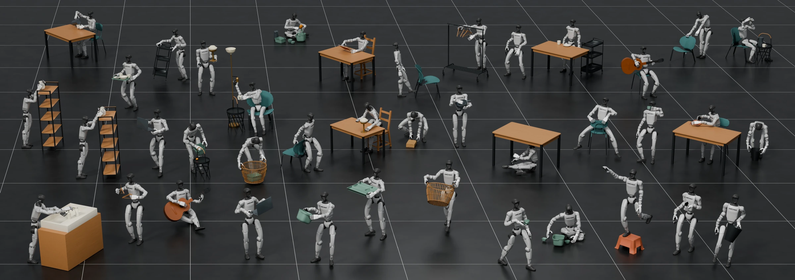

<p align="center">
  
</p>

<h1 align="center">DexWeave: Learning Dexterous Humanoid Loco-Manipulation from Human Demonstrations</h1>

<p align="center">
  <a href="https://naichuan04.github.io/">Naichuan Sun</a><sup>1,2,*</sup>,
  <a href="https://github.com/Tesla-SHT/">Haotian Shen</a><sup>1,*</sup>,
  <a href="https://openreview.net/profile?id=~Yizhang_Zhang1">Yizhang Zhang</a><sup>1</sup>,
  <a href="https://fengluying.github.io/">Luying Feng</a><sup>1</sup>,
  <a href="https://openreview.net/profile?id=~Haoze_Wang5">Haoze Wang</a><sup>1</sup>,<br>
  <a href="https://kam1107.github.io/">Yuanbo Xiangli</a><sup>2</sup>,
  <a href="https://en.westlake.edu.cn/faculty/yaochu-jin.html">Yaochu Jin</a><sup>1</sup>,
  <a href="https://ethliup.github.io/">Peidong Liu</a><sup>1,†</sup>
</p>

<p align="center">
  <sup>1</sup>Department of Artificial Intelligence, School of Engineering, Westlake University<br>
  <sup>2</sup>School of Artificial Intelligence, Shanghai Jiao Tong University<br>
  <sup>*</sup>Equal contribution &nbsp; <sup>†</sup>Corresponding author
</p>

<p align="center">
  <a href="https://dexweave.github.io/"></a>
  <a href="https://arxiv.org/abs/2609.34724"></a>
  <a href="https://huggingface.co/datasets/naichuan04/DexWeave"></a>
</p>

https://github.com/user-attachments/assets/8d1ddfe6-b401-4263-ac8c-0c2712ae731d

<p align="center">
  
</p>

**TL;DR:** DexWeave combines interaction-consistent motion retargeting with anatomy-aware reinforcement learning to enable dexterous humanoid loco-manipulation from human demonstrations.

## 🔥🔥🔥 News

- **2026-10-20:** Released the [HUMOTO and GRAB retargeted references](https://huggingface.co/datasets/naichuan04/DexWeave): 735 and 1,335 sequences, respectively, with matching evaluation NPZ files.
- **2026-09-30:** Released the [project website](https://dexweave.github.io/), [paper](https://arxiv.org/abs/2609.34724), and this repository.

## ⚒️ TODO

- [ ] Release code
- [x] Release paper

## Installation

Create the environment, then run all commands from the repository root.

```bash
git clone https://github.com/WU-CVGL/DexWeave.git
cd DexWeave
conda env create -f environment.yml
conda activate humoto-grab-viewer
python -m pip install -U huggingface_hub
```

## Data

| Dataset | Sequences | Frames at 50 Hz | opt / val files |
| --- | ---: | ---: | ---: |
| HUMOTO | 735 | 390,988 | 735 / 735 |
| GRAB | 1,335 | 676,647 | 1,335 / 1,335 |
| **Total** | **2,070** | **1,067,635** | **2,070 / 2,070** |

### Download all NPZ files

Download the retargeted motions and evaluation inputs from [Hugging Face](https://huggingface.co/datasets/naichuan04/DexWeave).


```bash
hf download naichuan04/DexWeave --repo-type dataset --local-dir . \
  --include "data/*"
```

The download is approximately 12.9 GB. For one dataset, replace `data/*` with `data/HUMOTO/*` or `data/GRAB/*`.

Keep each `_opt.npz` motion file with its matching `_val.npz` evaluation file. See the [Dataset Card](https://huggingface.co/datasets/naichuan04/DexWeave) for fields and coordinate conventions.

### Object meshes

Prepare the meshes before visualization or evaluation:

```bash
mkdir -p resources/objects/HUMOTO resources/objects/GRAB
```

- **HUMOTO:** obtain the object resources through the [official dataset access page](https://github.com/adobe-research/humoto#accessing-the-full-dataset). From `humoto_objects_0805/`, copy each `<object>/<object>.obj` and its matching `.mtl` into `resources/objects/HUMOTO/`, keeping the object subdirectories. See the [official data layout](https://github.com/Jiaxin-Lu/humoto#dataset-structure).
- **GRAB:** sign in to the [official download page](https://grab.is.tue.mpg.de/download.php) and obtain the object-mesh archive (`object_meshes.zip` in the official instructions). Copy its `contact_meshes/*.ply` files into `resources/objects/GRAB/`, including `table.ply`. Follow the [official mesh-access instructions](https://github.com/otaheri/GRAB#getting-started) if separate approval is required.

Include every scene object referenced by the sequence. Keep the original filenames, geometry, local coordinates, and units. Scripts match the filenames in the NPZ `object_mesh_paths` field.

### Directory layout after downloads

```text
DexWeave/
├── environment.yml
├── scripts/
│   ├── rerun_visualizer.py
│   ├── evaluate.py
│   └── motion_io.py
├── resources/
│   ├── g1/
│   │   ├── g1_rh56dfx.urdf
│   │   ├── g1_rh56dfx_mujoco.xml
│   │   └── meshes/                       # includes RH56DFX_L/ and RH56DFX_R/
│   └── objects/                        # user-downloaded; not distributed
│       ├── HUMOTO/<object>/<object>.obj   # retain matching .mtl files
│       └── GRAB/<object>.ply
└── data/
    ├── HUMOTO/<sequence>/<sequence>_{opt,val}.npz
    └── GRAB/<subject>/<sequence>/<sequence>_{opt,val}.npz
```

- Retain the GRAB subject directory, such as `s9/wineglass_pass_1`. Evaluation requires the MuJoCo XML, URDF, and meshes shown above.

- scripts load all robot and object resources from `resources/`.

- Sequences are discovered automatically under `data/` and a partial download evaluates only local sequences.

## Visualization

Open a complete sequence in Rerun:

```bash
python scripts/rerun_visualizer.py --dataset HUMOTO \
  --sequence write_on_notebook_with_pen_in_right_hand-329

python scripts/rerun_visualizer.py --dataset GRAB \
  --sequence s9/wineglass_pass_1
```

On a headless machine, save a recording to view later with Rerun 0.30.1:

```bash
python scripts/rerun_visualizer.py --dataset GRAB \
  --sequence s9/wineglass_pass_1 --save-rrd ../wineglass_pass_1.rrd
rerun ../wineglass_pass_1.rrd
```

Recordings contain every frame at 50 Hz. The `.rrd` output path must not already exist.

## Evaluation

Evaluate every frame of the downloaded sequences:

```bash
# All downloaded sequences
python scripts/evaluate.py --jobs 8

# One dataset
python scripts/evaluate.py --dataset HUMOTO --jobs 8
python scripts/evaluate.py --dataset GRAB --jobs 8
```

For a single sequence, use a separate output directory:

```bash
python scripts/evaluate.py --dataset GRAB --sequence s9/wineglass_pass_1 \
  --output evaluatioin_example
```

Resume an interrupted full run using the same output directory:

```bash
python scripts/evaluate.py --jobs 8 --resume
```

`--resume` reuses completed results.

### Metrics

| JSON field | Unit | Meaning |
| --- | --- | --- |
| `primary_finger_distance_mm` | mm | Thumb and index-finger position error |
| `secondary_finger_distance_mm` | mm | Middle, ring, and little-finger position error |
| `palm_orientation_deg` | deg | Palm-normal angular error |
| `penetration_duration` | ratio | Penetration-violation frames / all frames |
| `penetration_max_depth_cm` | cm | Sequence maximum; dataset mean over violating frames |
| `footskating_duration` | ratio | Foot-skating frames / valid support frames |
| `footskating_max_velocity_m_per_s` | m/s | Mean violating-frame speed, taking the faster foot per frame |


## Output format

A run covering both datasets creates:

```text
evaluatioin/
├── run.json
├── HUMOTO/
│   ├── metrics/<sequence>.json
│   ├── summary.json
│   └── result.txt
└── GRAB/
    ├── metrics/<subject>/<sequence>.json
    ├── summary.json
    └── result.txt
```

- **`metrics/...json`**: seven metrics per sequence and values needed for aggregation.
- **`summary.json`**: dataset metrics, sequence/frame counts, and failures.
- **`result.txt`**: automatically saved command, progress, and seven-metric terminal table.
- **`run.json`**: selected sequences and process count.

Summaries cover the current selection. After partial runs, use the full batch command with `--resume` to aggregate all downloaded sequences. Inapplicable metrics appear as `null` in JSON and `N/A` in the terminal; failures return a nonzero exit code.

## License

The visualization and evaluation code is released under the [MIT License](LICENSE). This does **not** license the motion data, object meshes, or third-party robot models under MIT.

- **HUMOTO-derived references:** subject to the [Adobe Research License v1.1](https://adobe-research.github.io/humoto/Adobe%20Research%20License%20v1.1.pdf) and any applicable dataset agreement. The Adobe license permits noncommercial research and teaching; redistribution requires a license copy and preserved copyright notices.
- **GRAB-derived references:** subject to the [GRAB terms](https://grab.is.tue.mpg.de/license.html) and the applicable written redistribution authorization. The public license permits noncommercial scientific research, education, and artistic use; further redistribution requires permission from Max-Planck.
- **Robot models and meshes:** retain their original third-party terms. The [Unitree BSD-3-Clause license](https://github.com/unitreerobotics/unitree_ros/blob/master/LICENSE) applies to materials originating from that repository, not to independently sourced Inspire hand resources. Preserve the applicable licenses, copyright notices, and disclaimers when redistributing these files.

## Citation

If you find this useful, please consider citing:

```bibtex
@article{sun2026dexweave,
  author  = {Sun, Naichuan and Shen, Haotian and Zhang, Yizhang and Feng, Luying and Wang, Haoze and Xiangli, Yuanbo and Jin, Yaochu and Liu, Peidong},
  title   = {DexWeave: Learning Dexterous Humanoid Loco-Manipulation from Human Demonstrations},
  journal = {arXiv preprint arXiv:2609.34724},
  year    = {2026},
  url     = {https://arxiv.org/abs/2609.34724}
}
```

## Acknowledgement

Please also cite the datasets used: [HUMOTO](https://adobe-research.github.io/humoto/), [GRAB](https://grab.is.tue.mpg.de/), and [ContactDB](https://contactdb.cc.gatech.edu/) for the GRAB object meshes. We thank the authors of [BeyondMimic](https://github.com/HybridRobotics/whole_body_tracking), [DeepMimic](https://github.com/xbpeng/DeepMimic), [OmniRetarget](https://github.com/amazon-far/holosoma), and [GMR](https://github.com/YanjieZe/GMR) for their open-source contributions.
